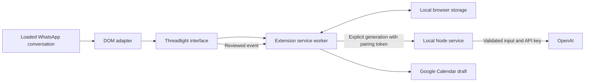

# Architecture and review

Reviewed on 28 October 2026 for version 0.2.2.

## Components and data boundaries

- `adapter.js` reads loaded message rows, names, selections, and the composer. It tracks a separate view identity to reject stale insertions, even when two chats have the same displayed name. Messages longer than 12,000 UTF-16 units are captured with an explicit truncation notice.
- `content.js` handles Write, Calendar, Memory, and Commitments. It requires a trusted user action for generation and external Calendar actions. Automatic capture does not call the model. It inserts drafts through the editor and never clicks Send.
- `layout.js` reserves a 400-pixel sidebar on wide windows or a bottom region on narrow windows. Scoped CSS constrains WhatsApp’s app shell without rewriting its inline styles or moving its nodes. Closing restores the original layout.
- `commitments.js` formats titles, dates, status, source quotations, and attribution as plain text. It hides recognized technical metadata without changing the stored task source used for Calendar.
- `background.js` validates the calling extension surface, validates inputs, serializes persistence, and owns pairing credentials. Content scripts cannot retrieve the pairing token. Calendar account preferences are global; conversation memory remains scoped by the configured WhatsApp account label and displayed contact/group name.
- `memory.js` handles bounded history, deduplication, imports, style examples, commitments, and migration. Failed storage writes do not leave a misleading in-memory success. Clearing a chat invalidates late commitment writes.
- The Node service binds only to `127.0.0.1:4318`. It checks host/origin, uses a session plus CSRF protection for setup, and requires a pairing token for generation. The API key stays in an owner-only local config file and is not returned to the setup page.
- `provider.mjs`, `validation.mjs`, and `media.mjs` validate and process model requests. Responses requests disable storage and expose no action tools. Text credentials are redacted; explicitly attached binary media is unchanged. FFmpeg uses bounded local processing with restricted protocols and removes temporary files.
- Google integration opens the account chooser or a reviewed, prefilled Calendar event. A saved email selects the requested account. Threadlight has no Google OAuth grant, calendar-reading permission, or silent event-creation capability.

## Review fixes

The review covered all production JavaScript, extension permissions/options, styling and docking, setup/configuration, the launcher, and the existing regression suites. Concrete issues fixed include:

- Concurrent setup saves and token rotation could overwrite newer settings. Updates now serialize against the last committed config.
- Requests waiting for their bodies could bypass the two-generation limit. The limit is checked again after body validation.
- A single oversized DOM message could reject an entire history capture. The adapter now bounds each captured message and labels truncation; imports remain strict.
- Synthetic page clicks could trigger model generation or Calendar actions. Privileged interface actions now require trusted browser events.
- Calendar requests could return an old preview after the source was edited. Changed event details now invalidate the result.
- Rapid Generate clicks during history refresh could start duplicate model requests. A preparation lock now covers that asynchronous step.
- Focusing WhatsApp’s search input could invalidate the conversation view and clear the assistant draft. Search focus no longer counts as navigation.
- Very long transcripts were truncated without disclosing missing speech. The model and interface now receive an explicit coverage notice.
- Null or malformed provider data and timeouts during response-body reading had misleading failures. They now return safe, actionable errors.

## Practical limits

Displayed names are the requested history key: duplicate names share memory, and renaming a contact selects another scope. Only loaded messages or explicitly imported exports are available. Media in a chat is represented by a placeholder until explicitly attached. WhatsApp can change its DOM, so synthetic tests complement live verification rather than replace it. Selecting a Google account is an account hint, not verification of sign-in; the final account and event are reviewed in Google Calendar.

See `VALIDATION.md` for exact automated and live test coverage.
