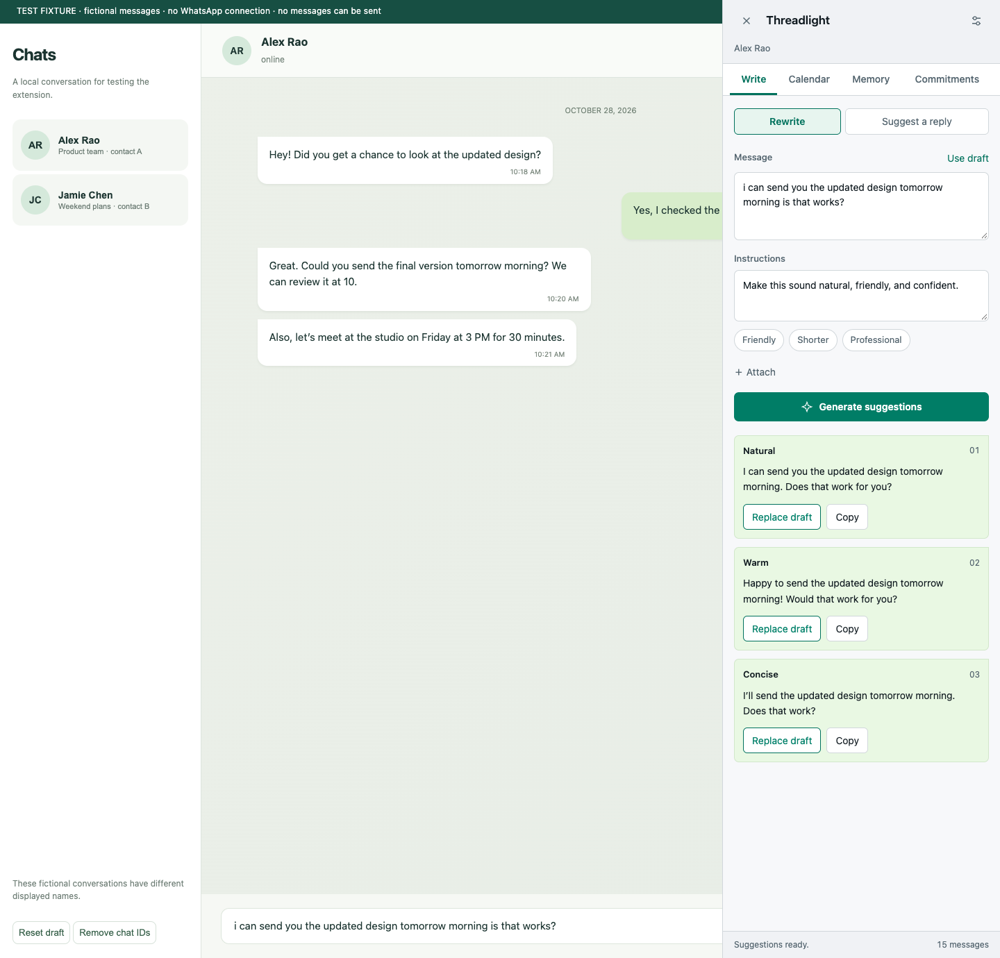

# Threadlight AI

A context-aware, multimodal writing assistant for WhatsApp Web, built with a Manifest V3 browser extension, a local Node.js bridge, and OpenAI.

Select text in WhatsApp, describe the change you want, and choose from three OpenAI suggestions. Use the explicit **Suggest a reply** action to draft a response using that conversation's captured context and your writing style.

The interface follows WhatsApp Web’s light or dark appearance, with opaque surfaces, green controls, and readable system typography. This is an unpacked Chrome/Chromium extension and a local Node service. It is a personal prototype, not an official WhatsApp integration. Historical question-answering is intentionally absent.



The preview uses fictional contacts and simulated suggestions. See [validation results](VALIDATION.md) for automated and live API checks.

## Start here

1. Use Node.js 22 or newer. In this folder, run `npm start`. No package installation is needed to run the service; it uses Node's built-in modules.
2. Open [local setup](http://127.0.0.1:4318/). Enter an OpenAI API key, save it, and copy the pairing token. The API key goes only into this local page, not WhatsApp or extension settings. Live API usage requires access and billing on your OpenAI API account.
3. In Chrome, open `chrome://extensions`. Enable **Developer mode**, choose **Load unpacked**, and select this project's **extension** folder. Brave and other Chromium browsers may also work; the automated browser checks use Chromium.
4. Open the extension's **Details → Extension options**. Paste the pairing token and save. Use **Test connection** to check local service readiness. This does not make a paid OpenAI call or validate the key against OpenAI.
5. Open or reload [WhatsApp Web](https://web.whatsapp.com/). Open a chat with loaded messages, then click the **Threadlight** button or press **Alt + Shift + W**.
6. History is selected automatically from the conversation's displayed name. No phone confirmation is required. Contacts or groups with the same displayed name share memory within the selected account; changing a name selects a separate history.

Keep the terminal running while you use the assistant. Press Ctrl+C there to stop it. On macOS, `Start Threadlight.command` is a convenience launcher for the same service.

## What you can do

- **Select → prompt → suggestions.** Highlight a message or part of a draft, choose **Ask Threadlight**, write instructions such as “make it friendly but direct,” and generate three options. Right-click selected text also offers rewrite and calendar actions. Ctrl/Cmd+Enter submits the prompt.
- **Suggest a reply.** Use the explicit button, optionally describe what you want to convey, and generate three responses. The current conversation, outgoing-message examples, accepted rewrites, and saved preferences supply context.
- **Use a draft.** Insert or copy a suggestion. A selected portion of your draft can be replaced without changing the rest. If the chat or draft changes after generation, insertion is refused so your new text is not overwritten. The extension never clicks Send.
- **Automatic conversation memory.** Loaded messages are captured and updated locally as you chat, including while the assistant panel is closed. Switching chats selects memory using the displayed contact or group name, within your configured WhatsApp account label. Scroll up to capture older loaded messages, or import a `.txt` export in Memory. For text imports, enter your exact sender name as it appears in the export. Names are normalized for whitespace and Unicode while preserving case. Matching names share history; renaming a contact selects a different history. The update preserves uniquely matching legacy histories; ambiguous legacy records remain stored without being merged.
- **Calendar.** Select a message and choose Calendar to open its dedicated tab. Review/edit the date, time, location, and notes. Ask Threadlight opens the separate writing tools. Missing details stay unresolved until you supply them. **Review in Google Calendar** opens a prefilled event; you must press **Save** in Google Calendar. The extension does not silently create events or invite participants.
- **Commitments.** Click **Find commitments** to review possible promises from retained history. Mark them done or dismissed. This is an on-demand inbox, not an always-running monitor or notification system.

## Images, voice notes, documents, and video

Download media from WhatsApp, then use **Attach media**. You can paste an image directly. Attached files are processed for the current generation; the extension does not silently download all historical attachments.

| Input | Processing |
| --- | --- |
| PNG, JPEG, WebP, non-animated GIF | OpenAI image input |
| PDF | OpenAI file input, including page visuals |
| Plain text | Text content supplied with the request |
| Audio / voice note | OpenAI transcription, then the transcript as context |
| Video | FFmpeg extracts sampled frames and audio, then OpenAI interprets them |

At most four files and 16 MB combined per request. FFmpeg enables format normalization, up to five minutes of audio processing, and up to the first 60 seconds of video with at most six sampled frames. Sampling is not exhaustive video understanding. The UI reports processing limits. Without FFmpeg, supported audio files can still be transcribed; video and formats requiring conversion return an actionable error. Install FFmpeg separately and put it on PATH, or set `FFMPEG_PATH` before starting the server.

Images, transcripts, names, and dates can be misinterpreted. Review suggestions and event details. A message's visible media placeholder does not give the assistant access to the file itself. Media binaries are not retained in the extension's memory.

## Data and configuration

- The bridge listens only on `127.0.0.1:4318`. It accepts paired extension requests and protects setup changes with same-origin checks and a session token.
- The OpenAI key and pairing token are stored in `.local/config.json`, with owner-only file permissions. This is not an encrypted vault. The extension never receives the OpenAI key.
- The extension stores its pairing token, chat memory, preferences, and accepted writing examples locally in the browser profile. Content scripts cannot directly access extension storage or retrieve the pairing token.
- Context and attached files are sent to OpenAI only when you request a generation. Responses calls set `store:false`; this does not mean all provider retention policies are disabled. WhatsApp's encryption does not extend to this separate model-processing flow.
- Before sending text to the Responses API, the bridge redacts exact configured credentials and recognizable long OpenAI project/service-account keys from prompts, history, preferences, text attachments, and transcripts. This is not a general sensitive-data detector. It does not redact binary images, PDFs, audio, or video; audio is uploaded for transcription before transcript filtering.
- Default models: `gpt-5-mini` for text/images/documents, `gpt-transcribe` for audio. Change the names in local setup if your account uses different compatible models. Image/PDF/structured-output support depends on the selected model.
- `OPENAI_API_KEY` can be supplied as an environment variable instead of through setup. A locally saved key takes precedence.
- Memory retains up to 1,200 messages / roughly 650 KB per conversation and is also bounded across the browser profile. Coverage/removal indicators show limits. Retained history is searched and recent turns are supplied within a request budget; this is not guaranteed access to every historical message.
- **Switching WhatsApp accounts:** change the account label in extension settings, then reload WhatsApp before continuing. The label separates accounts; the DOM integration cannot independently verify which account is signed in.
- **Clear conversation** clears its local memory and learning examples. Automatic capture resumes as messages change. Closing the panel does not stop capture; close WhatsApp Web or disable the extension to stop it. Deleting browser extension data also removes local memory. Protect your browser profile and disk as you would other personal data.

## Integration limits

WhatsApp's DOM is not a stable public API. `extension/adapter.js` contains the selectors and identity extraction that may need updating after WhatsApp changes. Memory is keyed by the displayed contact/group name, so duplicate names share history and renamed contacts use a different history. A separate temporary view identity protects against inserting stale suggestions after switching chats. Rows already observed under a different name are skipped during header transitions; after an in-place rename, reload WhatsApp to capture those rows under the new name. Messages without reliable incoming/outgoing evidence are omitted. The assistant cannot read history that WhatsApp has not loaded or synced, and does not bypass protected/view-once media.

A public or business-distributed version would need a separate platform/privacy review. Personal use does not establish that an unofficial integration is supported by WhatsApp.

## Validation and development

```sh
npm ci
npx playwright install chromium
npm run check
npm test
npm run test:browser
npm run test:adapter
npm run test:theme
npm run test:extension
npm run test:setup
```

Unit/integration tests cover contact/account isolation, deduplication, retention, key access, source timestamps, stale writes, calendar validation, real OpenAI request construction with injected responses, no-key errors, and FFmpeg preprocessing. Browser tests use isolated Chromium profiles and fictional WhatsApp-shaped fixtures; they do not access your personal browser or send messages. Model responses in test fixtures are explicitly simulated. Production code does not produce fake suggestions when an API key is missing.

Live OpenAI text, image, audio, video, and calendar checks succeeded using fictional data. The extension was reloaded in a logged-in Brave session: automatic name selection, saved self-chat history, the removed phone/Progress UI, and the separate Calendar screen were verified. Automated checks include history updates while the panel is closed. Version 0.2.1 additionally passed 12 theme checks and was visually verified against WhatsApp’s dark appearance. Generation and insertion in real WhatsApp remain unverified. See `VALIDATION.md` for the scope and remaining checks. The demonstration screenshot uses synthetic contacts and simulated suggestions.

## Project map

- `extension/adapter.js`: WhatsApp DOM and safe draft insertion.
- `extension/content.js`, `content.css`: in-page assistant and selection actions.
- `extension/background.js`, `memory.js`: scoped persistence, legacy-history migration, and authenticated bridge calls.
- `extension/options.*`: connection and account settings.
- `server/`: loopback bridge, local setup UI, OpenAI requests, and media processing.
- `tests/`, `demo/`: isolated verification and fictional fixtures.

## References verified during development

[Chrome content scripts](https://developer.chrome.com/docs/extensions/develop/concepts/content-scripts) support reading/modifying webpage DOM. [Chrome context menus](https://developer.chrome.com/docs/extensions/reference/api/contextMenus) expose selected text. OpenAI implementation follows the official [Responses](https://developers.openai.com/api/reference/resources/responses/methods/create), [structured outputs](https://developers.openai.com/api/docs/guides/structured-outputs), [file inputs](https://developers.openai.com/api/docs/guides/file-inputs), and [transcription](https://developers.openai.com/api/docs/guides/speech-to-text) documentation.
